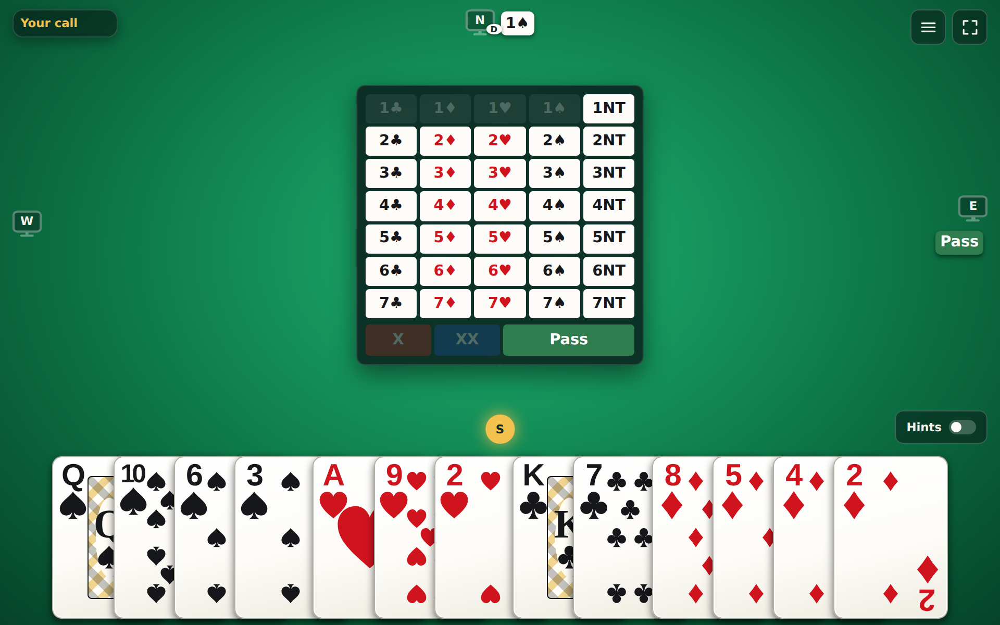
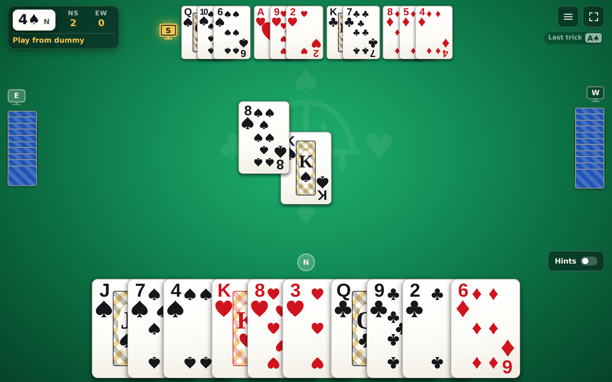
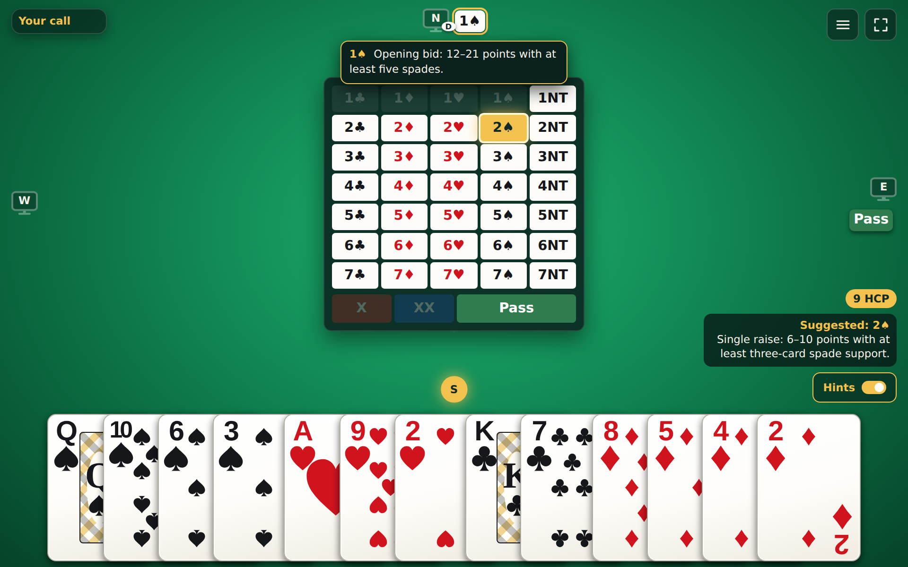

> ## 🔍 UI previews: every major screen without playing a hand
>
> Open **[`#/mocks`](https://contractplay.niuk.workers.dev/#/mocks)** on the live site, or `http://localhost:5173/#/mocks` after `pnpm web:dev` (`http://localhost:8787/#/mocks` after `pnpm server:dev`). One screen fills the window at a time, so you see the layout exactly as players do.
>
> | # | Screen | # | Screen |
> |---|---|---|---|
> | 1 | Lobby | 6 | Dummy playing for a bot declarer |
> | 2 | Seating | 7 | Defending, dummy on your left |
> | 3 | Auction: your call | 8 | Defending, dummy on your right |
> | 4 | Auction with hints | 9 | Game menu |
> | 5 | Declaring 4♠ with dummy | 10 | Hand result |
>
> - **Step through:** the ‹ and › buttons in the bar at the bottom, or the ← and → keys. The address changes to `#/mocks/N`, so any screen can be bookmarked or linked directly, for example [`#/mocks/7`](https://contractplay.niuk.workers.dev/#/mocks/7).
> - **Inspect without the bar:** × hides it; the small `N/10` button brings it back. **Exit** returns to the app.
> - **Nothing is played or saved:** the screens are look-only. Clicks go nowhere, and names, hints, and hand history stay out of the browser's storage.
> - **Always current:** each screen is a real table state built with the same rules engine and reducer the server runs, projected with the server's `viewFor`, and drawn by the real `Lobby` and `OnlineTable` components. Layout and component changes appear in the previews automatically. `apps/client/src/mocks/Previews.test.tsx` checks that every screen still reaches its state (for example, that dummy is on your left in screen 7), so a change that breaks one fails `pnpm test`.
> - **Adding a screen:** add an entry to `previewScreens` in [`apps/client/src/mocks/scenarios.ts`](apps/client/src/mocks/scenarios.ts) and its expectation in `Previews.test.tsx`.

<p align="center">
  
</p>

<h1 align="center">ContractPlay</h1>

<p align="center">Play, learn, and review contract bridge.</p>

<p align="center">
  
  
</p>
<p align="center">
  
</p>

---

## Status

ContractPlay currently provides a responsive browser table for local deals, configurable bots, PBN import/export, autosaved play, take-back, named hand history and review, hints, and, once the service is deployed, online tables. At any point in a deal you can hand the rest of the hand to the bots from the table menu. With the Hints switch on, the table shows your high-card points, the suggested call or card with a reason, and the meaning of any call you click.

Windows and macOS installer builds and an iOS app build/install/launch on an iPad simulator have passed on GitHub Actions. The web app and online tables are deployed together to Cloudflare at https://contractplay.niuk.workers.dev. The old GitHub Pages copy has no online entry and is no longer updated. Signed and physical-device builds remain pending their documented setup steps, and `bridge.romaniuk.us` is not set up. Voice and video chat remain planned. See the [platform delivery guide](docs/platform-delivery.md), [roadmap](TODO.md), and [change history](CHANGES.md).

## Project structure

```text
apps/client/          React and Vite browser client
apps/server/          Cloudflare Worker that serves the client and runs online tables
apps/client/src-tauri/ Tauri host for desktop and iOS/iPadOS
packages/core/        Platform-neutral cards, rules, and game state
packages/pbn/         PBN parser, serializer, and diagnostics
packages/persistence/ Versioned local game storage
packages/bots/        Bidding and card-play strategies
packages/protocol/    Messages shared by the client and the online service
packages/table/       Online table rules: seats, host, presence, scoring totals
docs/superpowers/     Feature plans and specifications
```

The core package owns legal actions and immutable game transitions. PBN, persistence, bots, and the client build on its shared types and APIs.

## Bots

Choose Beginner, Intermediate, Advanced, or Expert play, and configure SAYC or 2/1 bidding. All levels share one set of partnership agreements: opening bids, notrump structures, strong 2♣ and weak twos, major-suit raises with Jacoby 2NT, fourth suit, Blackwood, and game-forcing 2/1 sequences, with answers to partner's doubles, overcalls, and forcing bids. Beginner bids constructively and does not start competitive action. Intermediate adds overcalls, takeout doubles, preempts, and action over the opponents' preempts and 1NT. Advanced adds balancing, reopening doubles, and light third- and fourth-seat openings, and in the play draws trumps, ruffs, and plays third hand high. Expert adds Gerber, splinters, Reverse Drury, and Lebensohl, and in the play cashes established winners and protects them when discarding. Bots use standard technique and do not see hidden hands, so they still make mistakes; rarer conventions and advanced card play such as squeezes and endplays are not covered.

Hints are off by default. Suggestions are the Expert bot's choice in the selected bidding style, based on standard technique and not on seeing all four hands, so they can be wrong. Call meanings cover common SAYC and 2/1 situations and fall back to a plain natural description elsewhere. If a host supplies a solver, card hints show its legal recommendations instead.

## Online tables

Online tables let four people, with bots filling any empty seats, play one table together. They are live at https://contractplay.niuk.workers.dev. To try them locally, run `pnpm server:dev` and open http://localhost:8787.

- **Lobby.** The lobby lists open tables. A table can be unlisted and then is reachable only by its link, `<address>/#/table/<id>`. There are no accounts: you choose a display name (1-20 characters), and the browser keeps a device secret in local storage that the service stores only as a hash. Clearing browser data or switching device loses your seat.
- **Seats.** Each of the four seats is empty, a person, or a bot at a skill level you choose. A hand needs all four seats filled and at least one person. The first person to sit is the host and can remove a person between hands; any seated person can free an away player's seat between hands. A newcomer can only take an empty seat.
- **Play.** The service shuffles with a cryptographically secure generator and enforces every action with the same rules as the solo app. Each player receives only their own cards, dummy after the opening lead, and every hand when the hand ends; when Declarer is a bot, a present human partner in dummy controls both declaring-side hands. Someone not seated sees seats and score only. Bots act on the service after about a second. Each table keeps running totals, with each hand's points going to the side that scored them.
- **Away players.** The seat waits. Another seated player can hand it to an Intermediate bot, and the player takes it back on return. The host can hand a present but idle player to a bot after two minutes.
- **History.** Finished online hands are saved to the device's hand history for review and PBN export; passed-out hands are not saved.
- **Development admin.** Visit `/admin` on the Cloudflare-hosted app to see listed and unlisted tables and remove a table. This page and its API are currently open without sign-in; add RBAC before public production use.
- **Not available online:** accounts or sign-in, chat, voice or video, take-back, and PBN import.
- **Hints.** The Hints switch is off by default and remembered on the device. It shows high-card points and an Expert suggestion with a reason on your turn, and lets you click any auction call to see its meaning. Hints use only your visible hand, the public auction and play, and dummy once exposed.
- **Limits.** At most 100 listed and 400 unlisted tables; each public IP address can create 10 tables in any rolling 60-minute window. This limit is shared by everyone using the same public IP, and removing a table does not restore a creation. At most 32 identified connections per table; at most 8 connections per network address per table; at most 16 unidentified connections per table and 2 per address, each closed after 10 seconds. A table nobody ever joined is removed after 10 minutes, and any table after 24 hours with no person connected.

In the app, online play is reached from "Play online" on the start screen and "Online tables" in the table menu. Both are hidden when the app has no service address. The Cloudflare deployment serves the app and tables from one address, so it uses its own origin. The old GitHub Pages copy was built with `VITE_ONLINE_URL=none` and has no online entry; it is no longer updated. Online play is available in the web app only for now: desktop and iOS builds do not show it. Enabling it there needs the service address allowed in the app's content security policy and cross-origin access on the service, which is planned.

## Development

Requires Node.js 20 or later and pnpm.

```sh
pnpm install
pnpm test
pnpm typecheck
pnpm lint
pnpm build
```

Start the browser client with:

```sh
pnpm web:dev
```

Verify the static web package and build native desktop installers with:

```sh
pnpm web:verify
pnpm tauri:dev
pnpm tauri:build
```

The browser and native clients store the current hand and up to 25 completed hands locally. PBN deals can be pasted or imported from a file, and completed hands can be exported as PBN. See the [platform delivery guide](docs/platform-delivery.md) for iOS/iPadOS simulator builds, deployment, and signing requirements.

## Project guidance

- [AGENTS.md](AGENTS.md) contains shared project instructions.
- [CLAUDE.md](CLAUDE.md) and [GEMINI.md](GEMINI.md) mirror those instructions.
- Record roadmap changes in `TODO.md` and meaningful user-facing changes in `CHANGES.md`.

## License

MIT. See [LICENSE](LICENSE).
