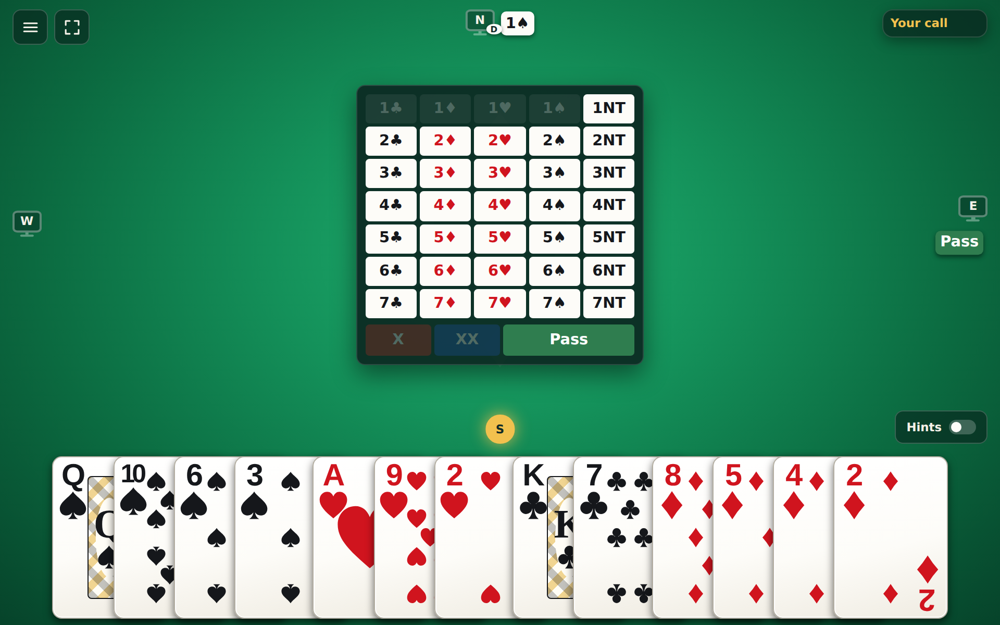
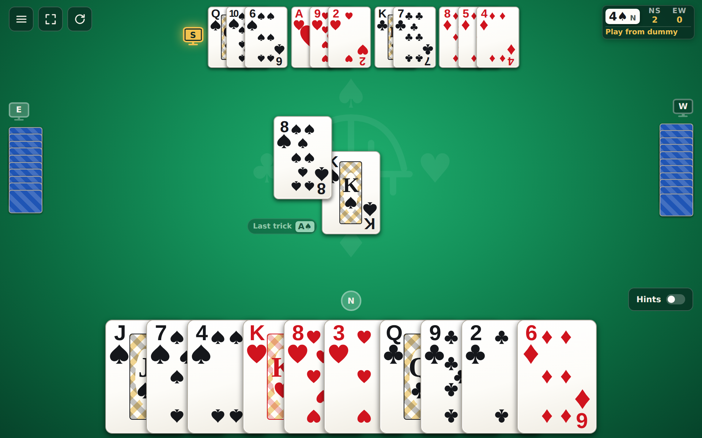
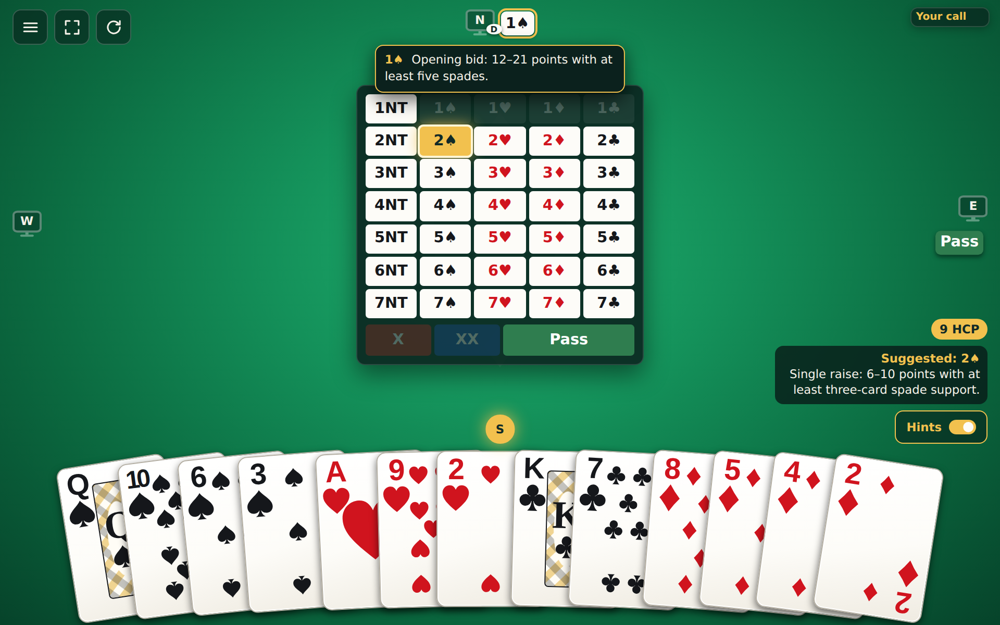

> ## 🔍 UI previews: every major screen without playing a hand
>
> Open **[`#/mocks`](https://contractplay.niuk.workers.dev/#/mocks)** on the live site, or `http://localhost:5173/#/mocks` after `pnpm web:dev` (`http://localhost:8787/#/mocks` after `pnpm server:dev`). One screen fills the window at a time, so you see the layout exactly as players do.
>
> | # | Screen | # | Screen |
> |---|---|---|---|
> | 1 | Lobby | 19 | Solo: declaring against bots |
> | 2 | Seating | 20 | Solo: dummy playing for a bot declarer |
> | 3 | Auction: your call | 21 | Solo: auto play |
> | 4 | Auction with hints | 22 | Solo: claiming |
> | 5 | Declaring 4♠ with dummy | 23 | Solo: game menu |
> | 6 | Dummy playing for a bot declarer | 24 | Solo: settings |
> | 7 | Defending, dummy on your left | 25 | Solo: recent hands |
> | 8 | Defending, dummy on your right | 26 | Solo: hand result with scorecard |
> | 9 | Card queued | 27 | Solo: rubber won |
> | 10 | Game menu | 28 | Solo: reviewing a saved hand |
> | 11 | Auto play | 29 | Solo: result against the field |
> | 12 | Claim waiting on you | 30 | Solo: viewing the original play |
> | 13 | Hand result | 31 | Solo: replayed deal |
> | 14 | Scores | 32 | Solo: replay result |
> | 15 | Rubber won | 33 | Online: replay result |
> | 16 | Online: duplicate session progress | 34 | Email sign-in |
> | 17 | Solo: new deal | 35 | Email link sent |
> | 18 | Solo: your call against bots | 36 | Online: waiting for the next deal |
>
> - **Step through:** the ‹ and › buttons in the bar at the bottom, the ← and → keys, or Space (Shift+Space goes back).
> - **Jump to a screen:** the picker in the bar groups the screens by what they show: lobby, seating and sign-in; bidding; card play; menus, claims and auto play; results and scoring; and reviewing hands. The address changes to `#/mocks/N`, so any screen can be bookmarked or linked directly, for example [`#/mocks/7`](https://contractplay.niuk.workers.dev/#/mocks/7).
> - **Inspect without the bar:** × hides it; the small `N/36` button brings it back. **Exit** returns to the app.
> - **Nothing is played or saved:** table and lobby clicks do not contact the server, and preview names, hints, and hand history stay out of browser storage. The email form advances only to its mock confirmation; it never sends a message.
> - **Always current:** each online table and lobby screen is built from a real table state and drawn by the real `Lobby` and `OnlineTable` components; screens 34–35 use the real email sign-in form with a mock request, and the solo screens (17–32) open the real solo app on a fixed hand with bots, forced cards, and queued cards held still; screen 33 is the online table after a replayed hand, and screen 36 an online result waiting for everyone to be ready. Layout and component changes appear in the previews automatically. `apps/client/src/mocks/Previews.test.tsx` checks that every screen still reaches its state (for example, that dummy is on your left in screen 7), so a change that breaks one fails `pnpm test`.
> - **Adding a screen:** add an entry to `previewScreens` in [`apps/client/src/mocks/scenarios.ts`](apps/client/src/mocks/scenarios.ts) and its expectation in `Previews.test.tsx`.

<p align="center">
  
</p>

<h1 align="center">ContractPlay</h1>

<p align="center">Play, learn, and review contract bridge.</p>

<p align="center">
  
  
</p>
<p align="center">
  
</p>

---

## Status

Recent hands can start another attempt on the same random deal; the new result compares against earlier attempts.

Deal replays: every second new hand (the 2nd, 4th, 6th and so on) may be an archived deal that someone first played at least 24 hours earlier, in solo play and at online tables outside duplicate sessions. Solo and online keep separate pools: online tables replay only deals first dealt at an online table, and solo only deals first played in solo, so nobody can collect or plant the cards of a deal an online table will replay. A replayed hand shows a notice with when the deal was first played and that you may have played it before; once the hand ends, the result is set against the deal's earlier results, with a headline in IMPs against the average of the deal's earlier results (the Butler datum) from your side, an `Original:` line (contract, declarer, tricks, North-South score and date), and a note when earlier results were rescored at your vulnerability. When no replay is available, or the archive cannot be reached, a fresh hand is dealt as usual. The archive is anonymous: it keeps only the deal, its auction and play, and the result, with no names, account or player ids, or table ids, and it holds finished hands only (from online tables and from solo hands against bots, never ones played at a manual table, imported, in a board set, or replayed with "Play this deal again"). It needs the `0003_deal_archive.sql` D1 migration; see [the deployment runbook](docs/platform-delivery.md).

Email magic-link sign-in, account seat recovery, and account-owned hand history (online hands and dealt solo hands) are implemented and tested. Live magic-link delivery has been verified. The online deployment opens on the account-gated lobby, whose **Play** panel starts a game against bots on this device (**Me and bots**) or an online table (**With other people**). Cross-device seat recovery and archive sync still need live verification. See the [deployment runbook](docs/platform-delivery.md#email-sign-in-prerequisites). `/admin` is still open without sign-in; authorization and invitations remain planned.

ContractPlay currently provides a responsive browser table for local deals, configurable bots, PBN import/export, autosaved play, take-back, named hand history and review, hints, and online tables. Solo and online tables share one game menu (☰, top left, beside the full-screen button; the status card with the contract and tricks is top right): Claim, **Take back** (your last call or card), and **Auto play this hand**, which lets a bot make your calls and play your cards until the deal ends (in the auction or the play), then gives them back. Its banner sits clear of every hand (top left, under the menu), can be dragged anywhere on the table, and has **Stop auto play**. Rubber tables, solo and online, add **Scores**, which opens the rubber scorecard at any time; solo play also adds Settings, Recent hands (review, export, and PBN import), About, and Deal a new hand to the same menu, and online tables add **Recent hands** too; there is no Redo. Each saved hand is named after the cards you were dealt: each suit's letter followed by its cards from the ace down (T for ten), suits in the order spades, hearts, clubs, diamonds, joined by underscores, for example `SKT9_HKQJ32_CA2_D543`; a void is its letter alone (`H`). Against bots and online it is your seat's hand, otherwise South's, and a repeat of a hand already in the list gets `_2`, `_3`, and so on. Hands saved earlier keep their old names. A card that is your only legal play (a singleton in the led suit, or your last card) is played for you after a short pause; turn this off with "Play forced cards automatically" in the deal settings. You can claim the remaining tricks on your turn, either all of them or a number: against robots they check the claim with an exact search, online every human opponent must accept it, and a claimed hand is saved, reviewed, and exported to PBN with its result. While another player is to act you can click one of your cards (or dummy's, if you control it) to queue it; it plays half a second after your turn starts if still legal, and clicking it again unqueues it. Seats whose cards you cannot see show one card back per card held, during card play. The **Last trick** badge, with the card that won it, lies on the table beside the winner's place in the trick, the way a won trick is gathered in front of its winner; click it to lay the whole trick out again. Click any call at a seat to see what it means, with or without Hints. With the Hints switch on, the table also shows your high-card points and the suggested call or card with a reason.

Windows and macOS desktop builds are on hold and will probably be deprecated in favour of the web app: their installer workflows still exist, but they are no longer a target and get no new work. iOS and iPadOS are paused too: the Tauri host still supports them, but CI no longer builds them (see the [platform delivery guide](docs/platform-delivery.md) to resume). The web app and online tables are deployed together to Cloudflare at https://contractplay.niuk.workers.dev. The old GitHub Pages copy has no online entry and is no longer updated. Signed and physical-device builds remain pending their documented setup steps, and `bridge.romaniuk.us` is not set up. Voice and video chat remain planned. See the [platform delivery guide](docs/platform-delivery.md), [roadmap](TODO.md), and [change history](CHANGES.md).

## Project structure

```text
apps/client/          React and Vite browser client
apps/server/          Cloudflare Worker that serves the client and runs online tables
apps/client/src-tauri/ Tauri host for desktop (and iOS/iPadOS, paused)
packages/core/        Platform-neutral cards, rules, and game state
packages/pbn/         PBN parser, serializer, and diagnostics
packages/persistence/ Versioned local game storage
packages/bots/        Bidding and card-play strategies
packages/protocol/    Messages shared by the client and the online service
packages/table/       Online table rules: seats, host, presence, scoring totals
docs/superpowers/     Feature plans and specifications
```

The core package owns legal actions and immutable game transitions. PBN, persistence, bots, and the client build on its shared types and APIs.

## Bots

Choose Beginner, Intermediate, Advanced, or Expert play, and configure SAYC or 2/1 bidding. All levels share one set of partnership agreements: opening bids, notrump structures, strong 2♣ and weak twos, major-suit raises with Jacoby 2NT, fourth suit, Blackwood, and game-forcing 2/1 sequences, with answers to partner's doubles, overcalls, and forcing bids. Beginner bids constructively and does not start competitive action. Intermediate adds overcalls, takeout doubles, preempts, and action over the opponents' preempts and 1NT. Advanced adds balancing, reopening doubles, and light third- and fourth-seat openings, and in the play draws trumps, ruffs, and plays third hand high. Expert adds Gerber, splinters, Reverse Drury, and Lebensohl, and in the play cashes established winners and protects them when discarding. Bots use standard technique and do not see hidden hands, so they still make mistakes; rarer conventions and advanced card play such as squeezes and endplays are not covered.

Bot aggressiveness (Conservative, Normal, or Aggressive) sits beside skill and bidding style, in solo settings and when creating an online table. Normal is each skill level's own rules. Aggressive bots open light two-suiters by the Rule of 20, overcall a good five-card suit on 7–10 points, and compete one more level (to the three level) in a found fit; in the play the defenders cash the ace from A-K against a suit contract and second hand wins the trick when it can. Conservative bots pass openings under 12 points, preempts without two of the top three honors, overcalls under 10 points (12 at the two level), takeout doubles under 13, and three-level competitive raises under 8, but never pass a forcing call; in the play second hand plays low and the defenders lead against a suit contract from a sequence or a suit without the ace or king. Hints always follow Normal.

Hints are off by default. Suggestions are the Expert bot's choice in the selected bidding style, based on standard technique and not on seeing all four hands, so they can be wrong. Call meanings cover common SAYC and 2/1 situations and fall back to a plain natural description elsewhere. If a host supplies a solver, card hints show its legal recommendations instead.

## Online tables

Online tables let four people, with bots filling any empty seats, play one table together. They are live at https://contractplay.niuk.workers.dev. To try them locally, run `pnpm server:dev` and open http://localhost:8787.

- **Lobby and guests.** The online deployment opens on the online lobby; sign in with an email magic link to see **Open tables**, then the **Play** panel, then **New duplicate session**. All three start collapsed to their headers (Open tables shows how many tables are open, Play the mode last chosen, and the duplicate session form a small flask marking it as experimental, since sessions have not been tried in a real game yet); click a header to open its table list or form, and again to close it. Play offers (**Me and bots**, which deals a solo hand on this device and resumes one still in progress, or **With other people**, which creates an online table). Solo remembers its opponents, seat, bot skill, bidding style, and bot aggressiveness, and starts against bots when nothing is saved. A table can be unlisted and then is reachable only by its link, `<address>/#/table/<id>`. Direct table links still support guest play with a display name; the browser keeps a device secret in local storage that the service stores only as a hash. Clearing browser data or switching device loses an unlinked guest seat. A development build without an online service opens solo play directly.
- **Email accounts.** Choose **Sign in or register** to receive a single-use link valid for 15 minutes. Under the email form, a short panel says what ContractPlay is for: following your game over time, with replayed deals compared in IMPs, Auto play to let a bot finish a dull hand, every finished hand kept on your account, and bots with hints that explain calls. Under those points a short tour crossfades through seven screenshots of the table (hints, declaring, the last trick, Auto play, the result with the auction, a replayed deal's IMPs, and the lobby), about four seconds each; it pauses while you hover over it, stays still when your system asks for reduced motion, and a click opens that screen's preview. The screenshots come from the previews: after a visible change to one of them, run `node scripts/capture-sign-in-tour.mjs` against `pnpm web:dev` (see the script for its Playwright setup) to retake them. Open it in the browser you want to sign in; the session lasts 30 days, and **Sign out** ends only that browser's session. Starting sign-in from an existing guest browser links that guest identity after email verification. Your account name is set when the account is created: the guest name already saved in that browser, or "Player" if there is none. **Change name** next to "Signed in as" in the lobby renames the account (up to 20 characters) on every device; a table you are seated at shows the new name when you next open or rejoin it. Signing into the same account on another device recovers its linked seat. If several linked identities occupy one table, the app asks you to have the host free the extra seat between hands before reopening it. Sign-in requires the deployment setup linked above; the check-email message deliberately does not confirm account existence or mail delivery.
- **Recent hands.** The lobby and online game menu open hand history for review and PBN export. Completed online hands are saved when the table page is open at completion, with the seat you played; passed-out hands are not saved. Guests keep the most recent 25 local hands alongside solo hands. Signed-in players also sync a personal archive of their newest 25 online hands and, separately, their newest 25 solo hands on dealt or replayed deals across devices, including hands already saved in the current browser. Uploads are unverified personal records and never affect duplicate standings. Solo hands from imported files, board sets and "Play this deal again", unfinished solo play, settings, and the board-set library stay on the device. Network failures keep local history available for a later retry. **Delete** removes only the browser copy; an archived account hand returns on the next sync because server deletion is not implemented.

- **Seats.** Each of the four seats is empty, a person, or a bot at a skill level you choose. A hand needs all four seats filled and at least one person. The first person to sit is the host and can remove a person between hands; any seated person can free an away player's seat between hands. A newcomer can only take an empty seat.
- **Play.** The service shuffles with a cryptographically secure generator and enforces every action with the same rules as the solo app. Each player receives only their own cards, dummy after the opening lead, and every hand when the hand ends; when Declarer is a bot, a present human partner in dummy controls both declaring-side hands. Someone not seated sees seats and score only. **Claims:** on their turn, whoever controls the hand to act (the declarer for both declaring hands, a defender for their own) can claim "all remaining" or a number of the remaining tricks. Every human opponent must Accept; one Reject cancels it. A robot opponent accepts only when an exact search proves the claim, and rejects if the search cannot finish. The claimer can withdraw. While a claim is pending, play stops and the claimer's hand is shown to the opponents only (not to partner). After a rejection or withdrawal that side cannot claim again until the trick ends, and answers carry the claim's id, so a stale answer is ignored. The accepted claim ends the hand, and the result reads for example "Claimed by South (declarer): 3 of the remaining 4 tricks". Online tables use protocol version 8. Bots act on the service after about a second. **Scoring:** a new table scores rubber bridge unless its creator chooses running totals. **Bot aggressiveness:** the creator also picks Conservative, Normal, or Aggressive for every bot and stand-in at the table; the lobby lists tables with conservative or aggressive bots. At a rubber table the dealer rotates from North, vulnerability follows games won, each played hand goes on the rubber scorecard (passed-out and cancelled hands score nothing), and the deal after a won rubber starts a new one. **Scorecard:** at the end of every hand, solo and online, the result shows a paper-style bridge pad. The two partnerships sit either side of a vertical divider, headed "We" and "They" against bots or by the players' names online. Bonuses, overtricks, and penalties go above the line, written upwards; trick points go below it, game by game. Each won game closes with a dotted line and an arrow towards the side that won it, and a **Total** row sits under a double rule. Underneath, the last hand's points are explained line by line (contract points, overtricks, the insult, slam bonus, undertricks, honors, the game won, and the 700 or 500 rubber bonus). When a side wins the rubber, the card heads with the result and final score and offers **Deal a new rubber**, **Seating**, **Back to lobby**, and **Leave the table** online, or **Play another rubber** and **Online tables** solo; **Close** puts it away to see the cards. **Scores** in the game menu opens it at any time, and the seating screen shows it between hands. A running-totals table (and any table made before rubber scoring) keeps board-style dealer and vulnerability rotation and credits each hand's points to the side that scored them.
- **Hand result.** When a hand ends, all 52 cards stay on the table face-up at their seats, each hand with its high-card points and that seat's calls from the auction in order (click a call for its meaning), and the contract, outcome, score, table totals, and **Deal** sit in the middle. Online, **Deal** confirms you are ready: the next hand is dealt once every seated person who is present has confirmed (the button shows who it is still waiting for), so nobody's look at the result is cut short; bots, away players, and seats a bot is standing in for are not waited for. Each new hand, solo and online, opens with a short shuffle and deal on the felt (skipped when reduced motion is requested). **Seating** (also in the game menu) switches to the seat controls for changes before the next deal; **Show the hands** switches back. Solo hands end the same way, around the solo score panel.
- **Away players.** The seat waits. Another seated player can hand it to an Intermediate bot, and the player takes it back on return. The host can hand a present but idle player to a bot after two minutes.
- **Development admin.** Visit `/admin` on the Cloudflare-hosted app to see listed and unlisted tables and remove a table. This page and its API are currently open without sign-in; add RBAC before public production use.
- **Planned online:** additional permissions, table invitations, chat, and voice or video.
- **Hints.** The Hints switch is off by default and remembered on the device. It shows high-card points and an Expert suggestion with a reason on your turn, and lets you click any auction call to see its meaning. Hints use only your visible hand, the public auction and play, and dummy once exposed.
- **Limits.** At most 100 listed and 400 unlisted tables; each public IP address can create 10 tables in any rolling 60-minute window. This limit is shared by everyone using the same public IP, and removing a table does not restore a creation. At most 32 identified connections per table; at most 8 connections per network address per table; at most 16 unidentified connections per table and 2 per address, each closed after 10 seconds. A table nobody ever joined is removed after 10 minutes, and any table after 24 hours with no person connected.

In a development build with an online service configured, solo play is at `#/solo` and the online lobby is at `#/online`; the bare address opens the account-gated lobby. Builds without an online service open solo play directly. The Cloudflare deployment serves the app and tables from one address, so it uses its own origin. The old GitHub Pages copy was built with `VITE_ONLINE_URL=none` and has no online entry; it is no longer updated. Online play is available in the web app only: desktop and iOS builds do not show it, and with those builds on hold there is no plan to add it.

## Development

Requires Node.js 20 or later and pnpm.

```sh
pnpm install
pnpm test
pnpm typecheck
pnpm lint
pnpm build
```

Start the browser client with:

```sh
pnpm web:dev
```

Verify the static web package with `pnpm web:verify`. The Tauri desktop commands below still work but are on hold and will probably be deprecated (see [Status](#status)):

```sh
pnpm web:verify
pnpm tauri:dev
pnpm tauri:build
```

The browser and native clients store the current hand and up to 25 completed hands locally. PBN deals can be pasted or imported from a file; LIN hand records can be imported from a file. Select a PBN file together with its USEBIO XML results file to add the traveller to each matching board. Completed hands can be exported as PBN. A PBN file with several boards or a `ScoreTable` opens as a board set (experimental; see [Hand records and duplicate sessions](#hand-records-and-duplicate-sessions-experimental)). See the [platform delivery guide](docs/platform-delivery.md) for iOS/iPadOS simulator builds, deployment, and signing requirements.

## Hand records and duplicate sessions (experimental)

> **Experimental.** These features are still being worked on. Hand record imports have been checked with automated tests and sample files, but not a wide range of real club files, so expect rough edges. Open work is listed under "Hand records and replays" in [TODO.md](TODO.md).

There are two ways to play the same deals at multiple tables, and they answer different questions:

- **Board sets against the field** are for practicing or replaying hands from a club or tournament. You import the deals and, when available, the recorded traveller results. You play the boards solo against bots; **Against the field** compares your score with the results already in that file. No other BridgeLab tables need to be playing.
- **Online duplicate sessions** are for running a new multi-table event in BridgeLab. From the online lobby, create 2–8 tables with 4–32 generated boards, or import up to 32 boards from a PBN file. Players join the different tables, and every table plays the same board. Boards unlock in order after all tables finish; BridgeLab compares those tables' scores by matchpoints or cross-IMPs and shows the session place. For imported PBN, only board number, deal, dealer, and vulnerability enter the session; traveller rows and original play stay out. This is live multi-table play, not a comparison with an imported historical field.

In short: a **board set** compares your practice result with a field already recorded in a hand record; a **duplicate session** creates a live field from BridgeLab tables playing together.

### Board sets against the field

Play boards that were really played at a club or tournament, then see how your result compares with the other tables (the *field*).

- **Import.** In solo play, open **Import a PBN deal** (on the start screen, or ☰ → **Recent hands**) and choose a `.pbn` file. A file with several boards, or with a `ScoreTable` (the field's results), opens as a *board set*; a single board without results imports as one deal, as before. Boards that cannot be read are skipped with a message saying how many. The import panel also offers an eight-board CC0 practice set from Bridge Training; download it and choose the file to play it.
- **Play.** Each board is dealt fresh, with its dealer and vulnerability; the top-right status card shows where you are, for example "Board 7 · 1 of 24". **Next board**, **Finish board set**, and **Leave the board set** are in the game menu. Board-set hands stay out of the rubber.
- **Compare.** When a board ends, **Against the field** scores your result by the file's `Scoring` tag (matchpoints by default, Butler IMPs for `IMP` or `Butler`, cross-IMPs for `Cross`) and shows the field's results with your row highlighted. It shows the archive's `OptimumScore` when provided, otherwise it computes double-dummy par in a background Web Worker. A board without field results shows your own score and par.
- **Original play.** If the file records the auction and play, **View original play** steps through them with Previous and Next; **Back to your result** returns to the comparison.
- **Privacy.** Files stay in this browser. Player names in a `ScoreTable` are never stored or shown; only the deals, contracts, and scores are kept.
- **Saved progress.** The active board set and your place in it survive a reload in the same browser; finished boards go to Recent hands with their field. Leaving or finishing the set, or importing another file, drops it (a library of sets is on the roadmap).

### Where to find played boards and their fields

Use files you are entitled to: your own club's games or downloads a site offers to its players. BBO's terms forbid scraping and redistributing its records, and travellers with names are personal data, so ContractPlay does not ship or fetch any of these itself. Research and sources: [`docs/research/2026-11-13-hand-record-archives.md`](docs/research/2026-11-13-hand-record-archives.md).

| Source | What you can get | Field in the PBN? |
|---|---|---|
| **ACBL Live for Clubs** ([live.acbl.org](https://live.acbl.org)) | Each club game links a PBN hand record, a USEBIO XML results file, and an ACBLscore game file. | Yes, when the PBN and USEBIO files are selected together. |
| **BridgeWebs** club sites | Results with travellers; some clubs offer the PBN deal file. | Usually not. |
| **RealBridge** (event results pages) | The "full" PBN download: every table's auction and play of each board, with that table's contract and score. | Yes, read from the tables' own results: each board is played once with the other tables as its field. |
| **Your club's director** (Bridgemate, ACBLscore, other scoring programs) | Hand records exported as `.pbn`; some programs can write a PBN with a `ScoreTable`. | Sometimes: ask for "PBN with score table". |
| **Pianola** | Results pages with hands and travellers. | No (directors can download USEBIO). |
| **Vugraph Project** (Nikos Sarantakos) | Historic championship matches with full bidding and play, as `.pbn` / `.lin`. | No field, but **View original play** works. The site now redirects elsewhere; reach it through the Wayback Machine. |
| **Dealing programs** (Bridge Composer, Dealer4, BigDeal) | Files you make yourself. | Only if you add a `ScoreTable`. |

A typical club PBN carries the deals only. It still plays as a board set, but without a field comparison unless you select it together with the matching USEBIO results file. LIN files can be imported for their deal, auction, and play, but they do not carry a full traveller.

## Project guidance

- [AGENTS.md](AGENTS.md) contains shared project instructions.
- [CLAUDE.md](CLAUDE.md) and [GEMINI.md](GEMINI.md) mirror those instructions.
- Record roadmap changes in `TODO.md` and meaningful user-facing changes in `CHANGES.md`.

## License

MIT. See [LICENSE](LICENSE).

The browser's double-dummy par worker bundles `bridge-dds` 1.4.0, licensed under Apache 2.0; see [its license](docs/licenses/bridge-dds-1.4.0.txt).
